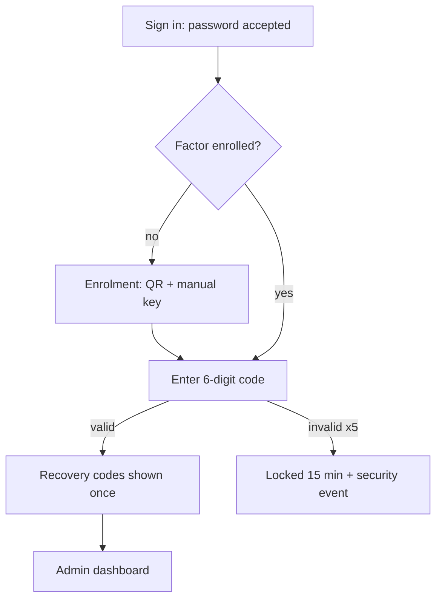

# UX Flows, States & Accessibility

## Specify every state — this is where late defects come from

For each screen, define all of:

| State | Must specify |
|---|---|
| Empty (first use) | What it says, what action it offers — never a blank region |
| Empty (no results) | How to recover: clear filters, broaden search |
| Loading | Skeleton or spinner, at what delay, and whether it blocks interaction |
| Partial | Some data loaded, some failed — what is shown and how failure is marked |
| Error (recoverable) | What happened, why, what to do next, retry affordance |
| Error (fatal) | Support path, error reference the user can quote |
| Permission denied | Distinguish "not allowed" from "does not exist" — carefully, this is a security choice |
| Offline / timeout | Retained input, retry behaviour |
| Success | Confirmation, what changed, where to go next |
| Destructive confirm | What will be lost, whether it is reversible, and a non-default destructive action |

A wireframe without these is not a specification; it is a picture.

## Flow specification

```markdown
## Flow: Admin enrols a second factor  (US-0107)



**Entry:** any admin route. **Exit:** dashboard, or locked.
**Interruption:** closing the browser mid-enrolment discards the unconfirmed secret; the user
restarts. Recovery codes are shown exactly once — the screen states this before revealing them.
**Copy:** "That code didn't match. Codes change every 30 seconds — check your app and try again."
(Never reveal whether the account exists or is locked to an unauthenticated caller.)
```

## WCAG 2.2 AA — what to actually check

**Perceivable**
- [ ] Text contrast ≥ 4.5:1 (≥ 3:1 for ≥ 24 px or ≥ 19 px bold); UI components and graphics ≥ 3:1
- [ ] Colour is never the only carrier of meaning — pair with text, icon or pattern
- [ ] Every image has an appropriate alt (empty alt for decorative)
- [ ] Content reflows at 320 px width without horizontal scrolling; works at 200% zoom
- [ ] Media has captions where applicable

**Operable**
- [ ] Everything reachable and operable by keyboard alone; no traps
- [ ] Focus order follows the visual/logical order; focus is always visible and not obscured (2.4.11)
- [ ] Target size ≥ 24×24 px (2.5.8)
- [ ] No content depends on a drag gesture without a single-pointer alternative (2.5.7)
- [ ] Timeouts are adjustable or warned; motion respects `prefers-reduced-motion`
- [ ] Skip link to main content; landmarks present

**Understandable**
- [ ] Labels are programmatically associated, visible, and persist (no placeholder-as-label)
- [ ] Errors identify the field, state the problem, and suggest a fix — in text, next to the field
- [ ] Errors are announced to assistive technology (live region or focus move)
- [ ] Consistent navigation and naming across screens
- [ ] Help is in a consistent location (3.2.6); re-entry of known information is avoided (3.3.7)

**Robust**
- [ ] Semantic HTML first; ARIA only where semantics are missing, and correct when used
- [ ] Every control has an accessible name that matches its visible label
- [ ] Status messages use appropriate live regions
- [ ] Verified with a keyboard and at least one screen reader before claiming conformance

## Report honestly

Each criterion: **pass** (with what you checked) · **fail** (with the defect and severity) ·
**not applicable** (with the reason). Never mark pass on a criterion you have not exercised
against the built interface — an accessibility report is a compliance claim.

## Rules

- Never invent user research. Label assumptions as assumptions.
- Reuse the design system; record gaps rather than inventing parallel components.
- Interaction behaviour before visual polish.
- Raise requirement conflicts with the Business Analyst; do not silently redesign the requirement.
